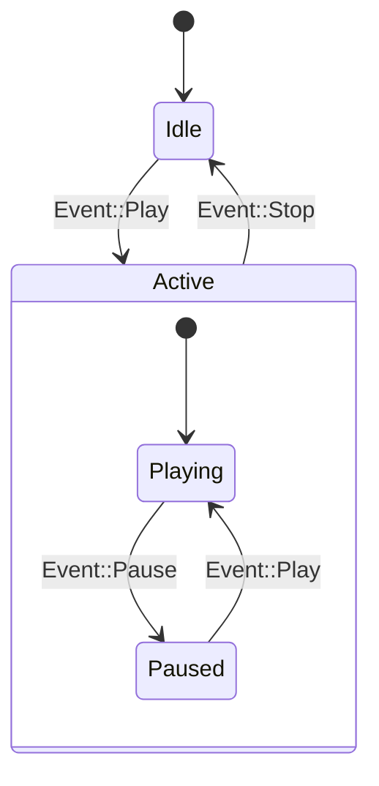

# Drawing and exporting the graph

Every machine has a static [graph](./03-state-data.md#state-ids-and-the-static-graph): its states, their nesting, and one edge for every `goto!` in your handlers. The `estado-graph` crate turns that graph into text you can read, diff and feed to other tools.

| Format | Method | Good for |
| --- | --- | --- |
| Mermaid | `to_mermaid()` | diagrams in Markdown, GitHub and docs |
| Graphviz DOT | `to_dot()` | rendering with `dot`, layout control |
| SCXML | `to_scxml()` | other statechart tools (W3C standard) |
| JSON | `to_json()` | scripts, dashboards, the inspector |

Add the crate:

```toml
[dependencies]
estado-graph = { git = "https://github.com/m4nd0r4s/estado" }
```

## A diagram of a machine

Import the `GraphExport` trait and call a method on `<Machine as Spec>::GRAPH`:

```rust
use estado::prelude::*;
use estado_graph::GraphExport;

#[derive(Debug, Clone, PartialEq, Eq)]
pub enum Event {
    Play,
    Pause,
    Stop,
}

#[estado::machine(event = Event)]
mod player {
    use super::*;

    #[root]
    pub enum Player {
        #[initial]
        Idle,
        Active(Active),
    }

    #[state]
    pub struct Active {
        #[substates]
        pub mode: Mode,
    }

    #[state]
    pub enum Mode {
        #[initial]
        Playing,
        Paused,
    }

    #[handlers]
    impl Player {
        #[on(Idle)]
        fn on_idle(event: &Event) -> Next<Self> {
            match event {
                Event::Play => goto!(Active),
                _ => unhandled!(),
            }
        }

        #[on(Playing)]
        fn on_playing(event: &Event) -> Next<Self> {
            match event {
                Event::Pause => goto!(Paused),
                _ => bubble!(),
            }
        }

        #[on(Paused)]
        fn on_paused(event: &Event) -> Next<Self> {
            match event {
                Event::Play => goto!(Playing),
                _ => bubble!(),
            }
        }

        #[on(Active)]
        fn on_active(_active: ActiveFields<'_>, event: &Event) -> Next<Self> {
            match event {
                Event::Stop => goto!(Idle),
                _ => unhandled!(),
            }
        }
    }
}

use player::Player;

fn main() {
    let diagram = <Player as Spec>::GRAPH.to_mermaid();
    assert_eq!(
        diagram,
        "\
stateDiagram-v2
    %% machine Player
    Idle
    state Active {
        Playing
        Paused
        [*] --> Playing
        Playing --> Paused : Event#58;#58;Pause
        Paused --> Playing : Event#58;#58;Play
    }
    [*] --> Idle
    Idle --> Active : Event#58;#58;Play
    Active --> Idle : Event#58;#58;Stop
"
    );
}
```

Paste the output into a Markdown file in a `mermaid` code block and it renders as a diagram:



The graph is exact. Every transition your code can make is an edge, and an edge that no code can take does not exist, so the picture cannot drift from the machine.

## What the pictures show

- **Compound states** are boxes with their substates inside and an arrow from `[*]` to the initial one.
- **Parallel states** are boxes split by `--` (Mermaid) or dashed boxes holding one dotted box per region (DOT).
- **Final states** (`#[terminal]`) have an arrow to `[*]` in Mermaid and a double border in DOT.
- **History** appears as a small `H` (shallow) or `H*` (deep) circle inside the compound state. A `goto!(State, history)` points at it.
- **Edge labels** are the event the `match` arm handles. Edges that are not plain transitions say so in brackets: `[timer]` for an `#[after]` event, `[always]`, `[done]`, `[history]`, `[external]`.

One limit to know: the graph records the event pattern as text, so an arm with a guard or a wildcard has a vague label or none (see [the reference](../reference/graph.md#limits)). The arrow from `[*]` at the top level points at the variant of the root enum marked `#[initial]`, wherever it is declared.

## Asking questions about the graph

The graph is data, so `estado-graph` can also answer questions about it. Import `GraphAnalysis`:

```rust
use estado::prelude::*;
use estado_graph::GraphAnalysis;

#[derive(Debug, Clone, PartialEq, Eq)]
pub enum Event {
    Play,
    Pause,
    Stop,
}

#[estado::machine(event = Event)]
mod player {
    use super::*;

    #[root]
    pub enum Player {
        #[initial]
        Idle,
        Active(Active),
    }

    #[state]
    pub struct Active {
        #[substates]
        pub mode: Mode,
    }

    #[state]
    pub enum Mode {
        #[initial]
        Playing,
        Paused,
    }

    #[handlers]
    impl Player {
        #[on(Idle)]
        fn on_idle(event: &Event) -> Next<Self> {
            match event {
                Event::Play => goto!(Active),
                _ => unhandled!(),
            }
        }

        #[on(Playing)]
        fn on_playing(event: &Event) -> Next<Self> {
            match event {
                Event::Pause => goto!(Paused),
                _ => bubble!(),
            }
        }

        #[on(Paused)]
        fn on_paused(event: &Event) -> Next<Self> {
            match event {
                Event::Play => goto!(Playing),
                _ => bubble!(),
            }
        }

        #[on(Active)]
        fn on_active(_active: ActiveFields<'_>, event: &Event) -> Next<Self> {
            match event {
                Event::Stop => goto!(Idle),
                _ => unhandled!(),
            }
        }
    }
}

use player::Player;

fn main() {
    let graph = <Player as Spec>::GRAPH;

    // Which states can ever be active? Which ones can never be left?
    assert_eq!(graph.reachable().len(), 4);
    assert!(graph.dead_ends().is_empty());

    // The shortest way from one state to another, as the edges to take.
    let idle = graph.find("Idle").unwrap().id;
    let paused = graph.find("Paused").unwrap().id;
    let path = graph.shortest_path(idle, paused).unwrap();
    let events: Vec<_> = path.infos(graph).map(|edge| edge.event_hint).collect();
    assert_eq!(events, [Some("Event::Play"), Some("Event::Pause")]);

    // The fewest walks from the initial state that take every edge: the
    // skeleton of a model-based test.
    let cover = graph.edge_cover();
    assert_eq!(cover.len(), 1);
    assert_eq!(cover[0].start(), graph.initial.unwrap());

    // The most entry and exit calls one transition can make, known at
    // compile time.
    const BOUND: usize = Player::WORST_CASE_ACTIONS;
    assert_eq!(BOUND, 3);
}
```

- `reachable()` lists the states the machine can get to from its initial state. Entering a compound state also enters its initial substate, and a handler on a compound state applies to everything inside it.
- `dead_ends()` lists the leaf states nothing can leave, apart from `#[terminal]` ones: the machine would be stuck there. The macro warns about both with W0001 and W0002.
- `shortest_path(from, to)` is a `Path`: the edges to take, as indices into `graph.edges`, with the event pattern of each in `event_hint`.
- `edge_cover()` is the smallest set of paths that together take every edge. Paths may overlap, and an edge no path can reach is left out.
- `WORST_CASE_ACTIONS` counts the entry and exit calls of the costliest transition, for timing analysis on a small target: `const _: () = assert!(Motor::WORST_CASE_ACTIONS <= 8);`.

The [reference](../reference/graph.md#analyses) says how each one treats history, timers, regions and the other corners.

## Keeping a diagram in the repository

Generated diagrams go stale when the machine changes, unless a test checks them. `assert_snapshot!` compares the export with a file you commit:

```rust,no_run
use estado::prelude::*;
use estado_graph::assert_snapshot;

#[estado::machine(event = ())]
mod light {
    use super::*;

    #[root]
    pub enum Light {
        #[initial]
        Off,
        On,
    }

    #[handlers]
    impl Light {
        #[on(Off)]
        fn on_off(_event: &()) -> Next<Self> {
            goto!(On)
        }

        #[on(On)]
        fn on_on(_event: &()) -> Next<Self> {
            goto!(Off)
        }
    }
}

#[test]
fn the_light_diagram_is_up_to_date() {
    assert_snapshot!(<light::Light as Spec>::GRAPH, "docs/light.mmd");
}
# fn main() {}
```

The format comes from the extension: `.mmd`, `.dot`, `.scxml` or `.json`. The path is relative to the crate that runs the test. The first time, and every time the machine changes on purpose, run the tests with `ESTADO_BLESS=1` to write the file, then look at the diff before you commit it:

```text
ESTADO_BLESS=1 cargo test
```

Without `ESTADO_BLESS`, a missing or different file fails the test and tells you where the first difference is.

## Next

The [reference page](../reference/graph.md) lists the exact output of each format, the JSON schema and the snapshot rules.
